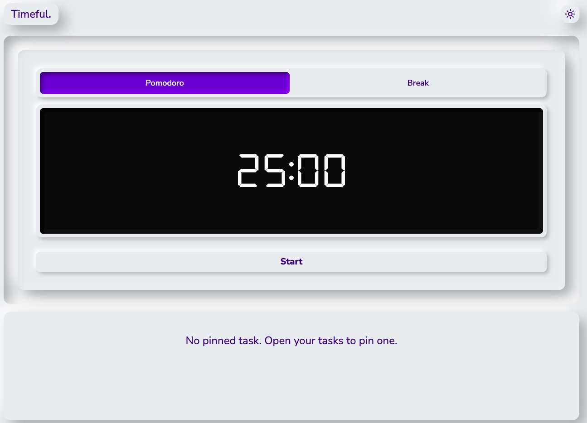

# Timeful.

A Pomodoro timer and task list in one simple web app.

🔗 **Live demo:** [timeful.vercel.app](https://timeful.vercel.app)



## Features

- Pomodoro timer with focus and break sessions that loop automatically
- Task list: add, rename, and delete tasks
- Pin one task to keep it visible while the timer is focused
- Tasks saved in your browser (localStorage), so they survive a refresh
- Light and dark mode
- Responsive layout for desktop and mobile
- Keyboard support (Enter to confirm, Escape to cancel when editing)

## Tech stack

- [React](https://react.dev/) + [TypeScript](https://www.typescriptlang.org/)
- [Vite](https://vite.dev/)
- [Tailwind CSS v4](https://tailwindcss.com/)

## Getting started

```bash
git clone https://github.com/MartinLe01/timeful.git
cd timeful
npm install
npm run dev
```

## What I learned

- Building my first project in TypeScript from the start
- Managing state with `useReducer` and typed actions in custom hooks
- Persisting and validating data from localStorage
- Building a neumorphism UI with Tailwind
- Debugging a Safari-only layout bug caused by percentage heights inside flexbox

## Credits

- 7-segment font: [DSEG](https://www.keshikan.net/fonts-e.html) by Keshikan (SIL Open Font License 1.1)
- Icons: [Material Symbols](https://fonts.google.com/icons)
- Font: [Nunito Sans](https://fonts.google.com/specimen/Nunito+Sans)
